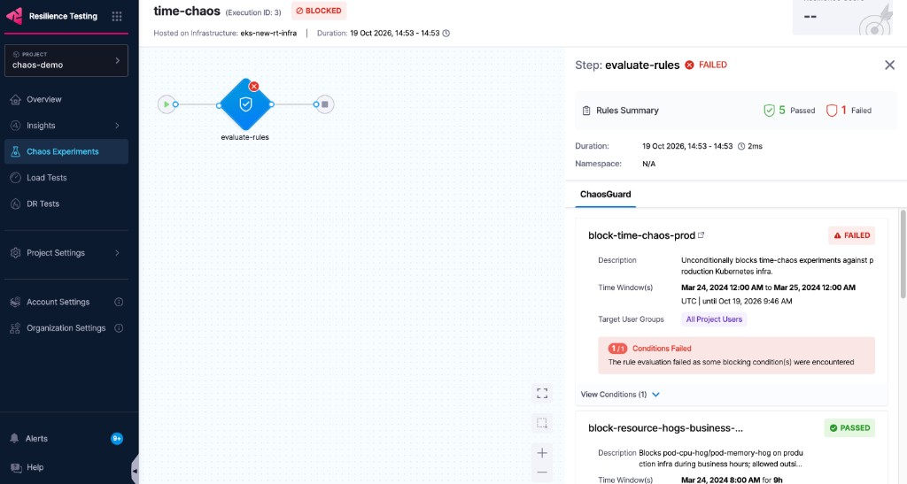
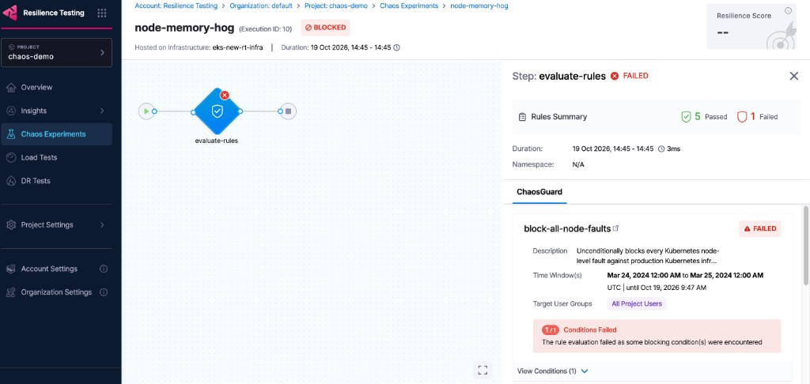

# ChaosGuard: Governance in Execution

Terraform module that provisions **ChaosGuard** guardrails for Harness
Chaos Engineering experiments, with **OpenShift (OSE)** as the primary
target and a Linux fault catalog for VM/host-based chaos infra.

## What ChaosGuard does

ChaosGuard runs **before** a chaos experiment is allowed to execute. It
blocks a run if it matches an active rule, based on:

| Clause | Meaning | Terraform field |
|---|---|---|
| **WHAT** | The fault (or faults) being requested | `fault_spec` |
| **WHERE** | The infrastructure the fault targets | `k8s_spec.infra_spec` / `machine_spec.infra_spec` |
| **WHICH** | The application under test: namespace, kind, label, services (K8s only) | `k8s_spec.application_spec` |
| **USING** | The chaos service account running the fault (K8s only) | `k8s_spec.chaos_service_account_spec` |

## Conditions and rules

- **Condition** (`harness_chaos_security_governance_condition`): a reusable
  match definition, WHAT fault and WHERE/WHICH/USING it applies. A
  condition by itself does nothing; it just describes a pattern of chaos
  runs.
- **Rule** (`harness_chaos_security_governance_rule`): binds one or more
  conditions to:
  - **who** it applies to (`user_group_ids`)
  - **when** it's active (`time_windows`: time zone, start time, duration,
    recurrence)
  - **on/off** (`is_enabled`)

  When a rule is enabled and its time window is active, any chaos run that
  matches one of its conditions is **blocked** for the targeted user
  groups.

Each guardrail in this module is one condition + one rule pair.

## What gets created

| File | Resources created |
|---|---|
| `k8s-chaos-guard.tf` | 6 conditions + 6 rules (Kubernetes faults) |
| `linux-chaos-guard.tf` | 4 conditions + 4 rules (Linux faults) |

20 resources total. IDs are exposed via `outputs.tf`.

Reference docs:
- [Configure Rules and Conditions for ChaosGuard](https://developer.harness.io/docs/resilience-testing/chaos-testing/governance/governance-in-execution/govern-run/)
- [`harness_chaos_security_governance_condition`](https://registry.terraform.io/providers/harness/harness/latest/docs/resources/chaos_security_governance_condition)
- [`harness_chaos_security_governance_rule`](https://registry.terraform.io/providers/harness/harness/0.42.1/docs/resources/chaos_security_governance_rule)

## Module layout

| File | Purpose |
|---|---|
| `versions.tf` | `terraform {}` / `provider "harness" {}` requirements |
| `variables.tf` | Input variables, with validation, shared by both fault domains |
| `k8s-chaos-guard.tf` | Conditions + rules for the `KubernetesV2` fault catalog (OSE) |
| `linux-chaos-guard.tf` | Conditions + rules for the `Linux` fault catalog |
| `outputs.tf` | Condition/rule IDs for every guardrail created |
| `terraform.tfvars.example` | Template to copy to `terraform.tfvars` and fill in per environment |
| `.gitignore` | Excludes local state, `.terraform/`, and filled-in `.tfvars` from version control |

## Fault inventory

### Kubernetes: example deployed experiment templates

| # | Template name | Underlying fault |
|---|---|---|
| 1 | `pod-delete` | `pod-delete` |
| 2 | `pod-api-block` | `pod-api-block` |
| 3 | `pod-network-loss` | `pod-network-loss` |
| 4 | `k8s-pod-progressive-cpu-hog` | `pod-cpu-hog` |
| 5 | `ssl-certificates-expiration` | `time-chaos` |
| 6 | `k8s-pod-progressive-network-loss` | `pod-network-loss` |
| 7 | `k8s-pod-progressive-network-latency` | `pod-network-latency` |
| 8 | `lowblastradius-zonal-regional-failures` | `pod-network-loss` |
| 9 | `highblastradius-zonal-regional-failures` | `node-network-loss` |
| 10 | `k8s-pod-progressive-memory-hog` | `pod-memory-hog` |

Deduplicated: 7 distinct faults guarded below (`pod-delete`,
`pod-api-block`, `pod-network-loss`, `pod-cpu-hog`, `time-chaos`,
`pod-network-latency`, `node-network-loss`, `pod-memory-hog`), plus the
entire node-fault category via Condition 6 (see below).

`pod-jvm-method-exception` is the only pod-level fault left unguarded.

| Fault | Risk |
|---|---|
| `pod-delete` | Low to Medium: pod is rescheduled, but still disruptive in customer-facing namespaces |
| `pod-api-block` | High: blocks egress to named hosts/ports |
| `pod-network-loss` | High: covers the standalone, progressive, and low-blast-radius variants |
| `pod-cpu-hog` | Medium: resource exhaustion |
| `pod-memory-hog` | Medium: resource exhaustion |
| `pod-network-latency` | Medium |
| `time-chaos` | Critical: skews system clock; can break TLS/cert validation, auth tokens, schedulers |
| `node-network-loss` | Critical: simulates a full zonal/regional outage |

### Kubernetes: complete node-fault catalog (blocked entirely)

Condition 6 blocks every fault in Harness's "Node faults" classification
against production infra, regardless of whether a template references it
today:

| Fault | Risk |
|---|---|
| `kubelet-service-kill` | Critical: node goes `NotReady` and evicts everything on it, faster-recovering than a full restart |
| `node-cpu-hog` | High: resource exhaustion, affects every pod on the node |
| `node-drain` | High: evicts every pod on the node (respecting PodDisruptionBudgets) |
| `node-io-stress` | High: disk I/O exhaustion, affects every pod on the node |
| `node-memory-hog` | High: resource exhaustion, affects every pod on the node |
| `node-network-latency` | High: affects every pod, DaemonSet, and control-plane agent on the node |
| `node-network-loss` | Critical: simulates a full zonal/regional outage |
| `node-restart` | Critical: full node reboot |
| `node-taint` | Medium: cordons future scheduling; does not immediately evict running pods |

This list does **not** include "Kubelet density" (`kubelet-density`), which
lives in Harness's separate "Kube-Resilience" fault category rather than
the standard Kubernetes node-fault classification. See
[Keeping the node-fault list current](#keeping-the-node-fault-list-current)
below.

### Linux fault catalog

| Fault | Risk |
|---|---|
| `linux-cpu-stress` | Medium |
| `linux-memory-stress` | Medium |
| `linux-network-latency` | Medium |
| `linux-network-loss` | High |
| `process-kill` | Critical: can kill a production process outright |

## Guardrails implemented

Tune `var.*` values (infra IDs, namespaces, service accounts, user groups,
time windows) per environment via `terraform.tfvars`.

### Kubernetes (`k8s-chaos-guard.tf`)

| # | Guardrail | Blocks | Scope |
|---|---|---|---|
| 1 | Protected-namespace pod-delete | `pod-delete` | `var.protected_namespaces`, always on |
| 2 | Clock-skew lockdown | `time-chaos` (`ssl-certificates-expiration`) | `var.k8s_prod_infra_ids`, always on |
| 3 | Zonal/regional outage lockdown | `node-network-loss` (`highblastradius-zonal-regional-failures`) | `var.k8s_prod_infra_ids`, always on |
| 4 | Protected-namespace network faults | `pod-network-loss`, `pod-network-latency`, `pod-api-block` | `var.protected_namespaces`, always on |
| 5 | Business-hours resource-hog freeze | `pod-cpu-hog`, `pod-memory-hog` | `var.k8s_prod_infra_ids`, `var.business_hours_*` window |
| 6 | Node-fault blanket block | All 9 node-level faults (see [catalog](#kubernetes-complete-node-fault-catalog-blocked-entirely)) | `var.k8s_prod_infra_ids`, always on |

### Linux (`linux-chaos-guard.tf`)

| # | Guardrail | Blocks | Scope |
|---|---|---|---|
| 1 | Process-kill lockdown | `process-kill` | `var.linux_prod_infra_ids`, always on |
| 2 | Business-hours resource-stress freeze | `linux-cpu-stress`, `linux-memory-stress` | `var.linux_prod_infra_ids`, `var.business_hours_*` window |
| 3 | Network-fault lockdown | `linux-network-latency`, `linux-network-loss` | `var.linux_prod_infra_ids`, always on |
| 4 | Change-freeze (all Linux faults) | All 4 faults above, one toggle | `var.linux_prod_infra_ids`, `var.change_freeze_*` window |

"Always on" = `Daily` recurrence, `until = -1` (no end date).

## Prerequisites

- [Terraform](https://developer.hashicorp.com/terraform/downloads) `>= 1.5.0`
- A Harness **Next-Gen Platform API key** with permissions to manage
  ChaosGuard conditions and rules in the target org/project
- Chaos infra IDs for the OSE (or other Kubernetes) and Linux
  infrastructure to protect

## Usage

1. Configure provider credentials via environment variables (never
   hardcode them in `.tf` or `.tfvars`):

   ```bash
   export HARNESS_ACCOUNT_ID="<account_id>"
   export HARNESS_PLATFORM_API_KEY="<platform_api_key>"
   export HARNESS_ENDPOINT="<harness_endpoint>"   # optional, defaults to https://app.harness.io/gateway
   ```

2. Copy and fill in variables:

   ```bash
   cp terraform.tfvars.example terraform.tfvars
   # edit terraform.tfvars with real org_id, project_id, infra IDs, etc.
   ```

3. Initialize, plan, and apply:

   ```bash
   terraform init
   terraform plan  -var-file=terraform.tfvars
   terraform apply -var-file=terraform.tfvars
   ```

4. Use a remote backend (S3, GCS, Harness-managed, etc.) instead of local
   state for shared/production usage. Add a `backend` block to
   `versions.tf` or pass `-backend-config` flags to `terraform init`.

## Customizing

- `k8s_prod_infra_ids` / `linux_prod_infra_ids`: production chaos infra
  IDs, composite `"{environmentId}/{infraId}"` format. **Required, at
  least one each.**
- `protected_namespaces`: namespaces that must never be targeted without
  extra approval.
- `service_accounts`: every chaos service account used in this project
  (default `["litmus"]`).
- `user_groups_ids`: user group(s) the rules apply to (e.g.
  `_project_all_users` to block everyone, or a narrower non-admin group so
  SREs/on-call can bypass via a separate group).
- `time_windows` variables (`start_time`, `time_zone`, `duration`,
  `recurrence`): match your business hours / change-freeze calendar.
- Toggle `is_enabled = false` on any
  `harness_chaos_security_governance_rule` to disable a guardrail without
  deleting it.
- New experiment templates: add a matching condition/rule pair and update
  the fault inventory tables above.

## Validation

```bash
terraform fmt -check -diff
terraform init -backend=false
terraform validate
```

`terraform validate` only checks schema, not whether a condition actually
matches a real experiment. After applying, always run one real chaos
experiment that should match each guardrail and confirm it's blocked.

### Implementation notes

- **Wildcards use `EQUAL_TO` against explicit values, not `NOT_EQUAL_TO`
  against a placeholder.** To match "any workload," `application_spec`
  uses `EQUAL_TO` with a wildcard `workloads` entry (`kind = "*"`, empty
  `label`/`namespace`). To match "any service account in use,"
  `chaos_service_account_spec` uses `EQUAL_TO` against
  `var.service_accounts`.
- **`infra_spec.infra_ids` must use composite `"{environmentId}/
  {infraId}"` format** (e.g. `"ose-prod/ose-cluster-01"`), matching
  `chaos_experiment.infra_id` elsewhere in Harness. A bare infra ID is
  schema-valid but never matches a real experiment.

## Example: blocked experiments

Real chaos experiment runs blocked by this module's guardrails:





## Keeping the node-fault list current

Condition 6 blocks node-level faults by explicit name, listed in
`local.node_level_faults` in `k8s-chaos-guard.tf` (the condition API has
no "match this category" operator).

To check for new node-level faults after a Harness release:

- Check the [Kubernetes node-fault category docs](https://developer.harness.io/resilience-testing/chaos-engineering/faults/chaos-fault-categories/kubernetes/node), or
- Query the catalog: `harness_list(resource_type="chaos_fault",
  filters={category: "node", infrastructure: "KubernetesV2"})`.

Add any new fault's name to `local.node_level_faults` and re-apply.
